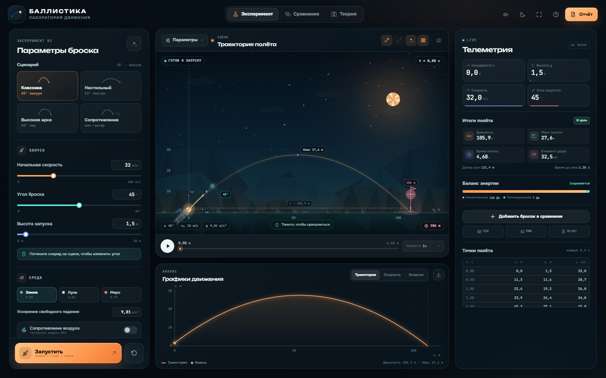

# Баллистика — интерактивная лаборатория

Компьютерная модель движения тела, брошенного под углом к горизонту. Полноценное офлайн-приложение для школьного проекта по физике: живая low-poly сцена, аналитическая и численная модели, графики, сравнение экспериментов, интерактивная теория и отчёт с сохранением в PDF.



## Возможности

- **Две физические модели**
  - точное аналитическое решение в вакууме;
  - численное интегрирование RK4 с квадратичным сопротивлением воздуха, попутным или встречным ветром.
- **Параметры эксперимента**: начальная скорость, угол, высота запуска, ускорение свободного падения (Земля, Луна, Марс или своё значение), масса, радиус и коэффициент сопротивления снаряда, плотность воздуха.
- **Сворачиваемая панель параметров**: кнопка «Параметры» на сцене убирает левую панель и расширяет область траектории — удобно на планшете.
- **Живая сцена**: low-poly пейзаж, пушка, снаряд, след, векторы скорости и компонент, сетка, максимальная высота, дальность и наземная мишень.
- **Перетаскивание прицела**: остановите полёт и потяните снаряд около пушки, чтобы изменить угол.
- **Автоприцел**: численный подбор угла под мишень с учётом сопротивления воздуха и ветра.
- **Графики**: траектория, проекции и модуль скорости, кинетическая / потенциальная / полная энергия; подсказки при наведении.
- **Журнал сравнения**: до пяти бросков с общим масштабом осей и разбором результатов. Примеры загружаются одной кнопкой.
- **Экспорт**: CSV с точками полёта, PNG сцены, PNG графика, PNG сравнения и отчёт в PDF. PDF формируется прямо в приложении и скачивается без открытия окна печати.
- **Теория и самопроверка**: формулы, методика исследования, ограничения модели и мини-квиз из четырёх вопросов.
- **Тёмная и светлая темы**, синтезированные звуки запуска и попадания, горячие клавиши, сохранение настроек и журнала в браузере.
- Полностью локальная работа: шрифты и все ассеты лежат в проекте, интернет не нужен.

## Быстрый запуск

### Совсем без установки

Откройте `index.html` двойным щелчком. Приложение собрано на обычных JS/CSS-файлах и работает без сборки и локального сервера.

### Через локальный сервер

Нужен Node.js 20+:

```bash
npm start
```

Откройте [http://127.0.0.1:4173](http://127.0.0.1:4173). Устанавливать зависимости для этого не требуется.

## Как пользоваться

1. Выберите сценарий или настройте скорость, угол и высоту запуска.
2. При необходимости включите сопротивление воздуха и задайте ветер.
3. Нажмите **«Запустить»** или клавишу `Space`.
4. Перетаскивайте время, меняйте скорость воспроизведения, изучайте графики.
5. Добавьте бросок в журнал сравнения и загрузите примеры для наглядного сопоставления.
6. Откройте отчёт и сохраните его в PDF либо выгрузите данные в CSV и PNG.

### Горячие клавиши

| Действие | Клавиша |
| --- | --- |
| Запуск / пауза | `Space` |
| Сбросить полёт | `R` |
| Векторы | `V` |
| Сетка | `G` |
| Сменить тему | `T` |
| Полный экран | `F` |

## Физика

Для идеальной модели (`y₀ = 0`):

```text
x(t) = v₀ cos α · t
y(t) = y₀ + v₀ sin α · t − ½gt²
T = (v₀ sin α + √(v₀² sin²α + 2gy₀)) / g
L = v₀ cos α · T
Hmax = y₀ + v₀² sin²α / (2g)
```

При включённом сопротивлении решается система

```text
ax = −k |v − w| (vx − wx)
ay = −g − k |v − w| vy
k = ρ Cd A / (2m),  A = πr²
```

методом Рунге — Кутты 4-го порядка. Удар о землю уточняется линейной интерполяцией между шагами. Модель считает снаряд материальной точкой, поверхность плоской, плотность воздуха постоянной; вращение, эффект Магнуса и кривизна Земли не учитываются.

## Структура

```text
ballistics-lab/
  index.html              разметка и SVG-иконки
  styles/
    fonts.css             локальные шрифты
    main.css              интерфейс и адаптивность
  src/
    physics.js            аналитика, RK4, метрики, автоприцел
    scene.js              отрисовка low-poly сцены и взаимодействие
    charts.js             графики и экспортные рендеры
    app.js                состояние, управление, сравнение, отчёт
    presets.js            сценарии и примеры
    audio.js              синтез звуков через Web Audio
  assets/                 логотип, иконки приложения, шрифты и лицензии
  electron/main.cjs       оболочка для будущего .exe
  build/                  иконки для electron-builder
  vendor/                 локальные html2canvas и jsPDF для PDF-отчёта
  tools/serve.mjs         локальный статический сервер
  tests/physics.test.cjs  проверки физического ядра
  docs/preview.png        скриншот интерфейса
```

## Тесты

```bash
npm test
```

Проверяются аналитические формулы, влияние высоты и сопротивления, попутный и встречный ветер, интерполяция, мишень, автоприцел и CSV-экспорт.

## Сборка `.exe` (на будущее)

Зависимости Electron уже описаны в `package.json`, но сейчас не установлены — приложение отлично работает как веб-версия. Когда понадобится `.exe`:

```bash
npm install
npm run electron:dev     # проверить приложение в отдельном окне
npm run dist:win         # собрать установщик и portable-версию
```

Результат появится в `dist/`:

- `Ballistika-Setup-1.0.0.exe` — установщик;
- `Ballistika-Portable-1.0.0.exe` — портативная сборка.

Сборка выполняется на Windows. В конфигурации уже заданы имя приложения, иконка, NSIS-установщик и portable-вариант. Электронная оболочка изолирована: Node.js в окне отключён, переходы на внешние адреса блокируются.

## Лицензии и ассеты

- Код проекта — MIT (см. `LICENSE`).
- Шрифты **Onest**, **Unbounded** и **JetBrains Mono** распространяются по SIL Open Font License 1.1; тексты лицензий лежат в `assets/fonts/`.
- Логотип, иконки, low-poly сцена и звуки созданы процедурно для этого проекта. Внешних изображений и звуковых файлов нет.
- **html2canvas 1.4.1** и **jsPDF 2.5.2** распространяются по лицензии MIT; локальные сборки и тексты лицензий лежат в `vendor/`.
